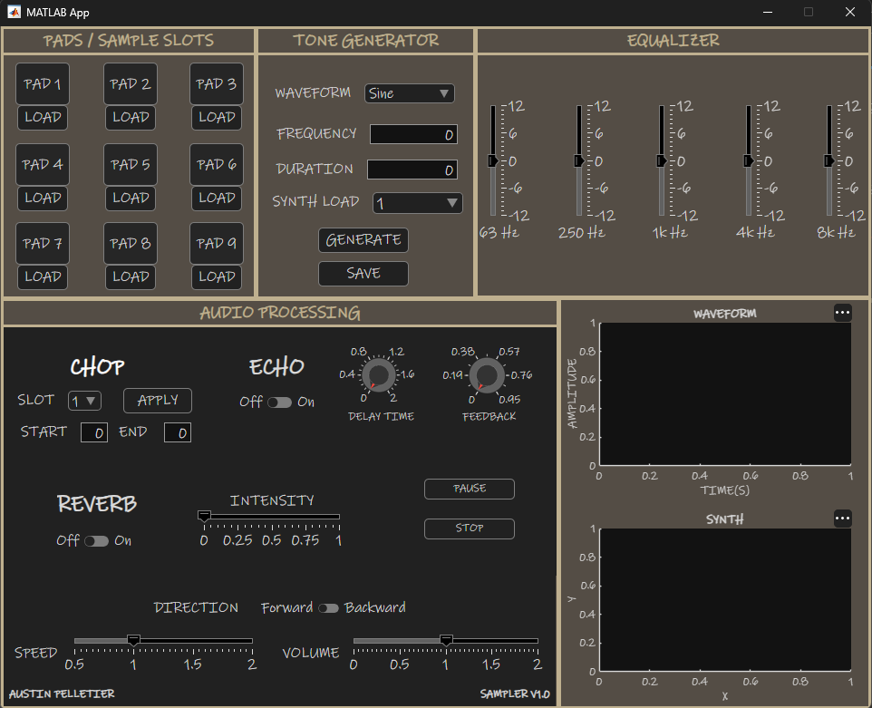

# MATLAB Audio Sampler

Interactive audio sampler developed using MATLAB App Designer.
The application allows users to load, manipulate, and play audio
samples through a graphical user interface. 

## Features

- Nine sample pads
- Audio playback and waveform visualization
- Adjustable playback speed and volume
- Echo, reverb, and other various effects
- Five-band equalizer
- Audio synthesizer

## Application Interface

## How to Run

1. Download or clone this repository.
2. Open `AudioSampler.mlapp` in MATLAB App Designer.
3. Click **Run** to launch the application.
4. Load audio samples and use the available playback and editing tools.

## Documentation

For more information about the application and its functionality,
see the [Project Documentation](README.pdf).